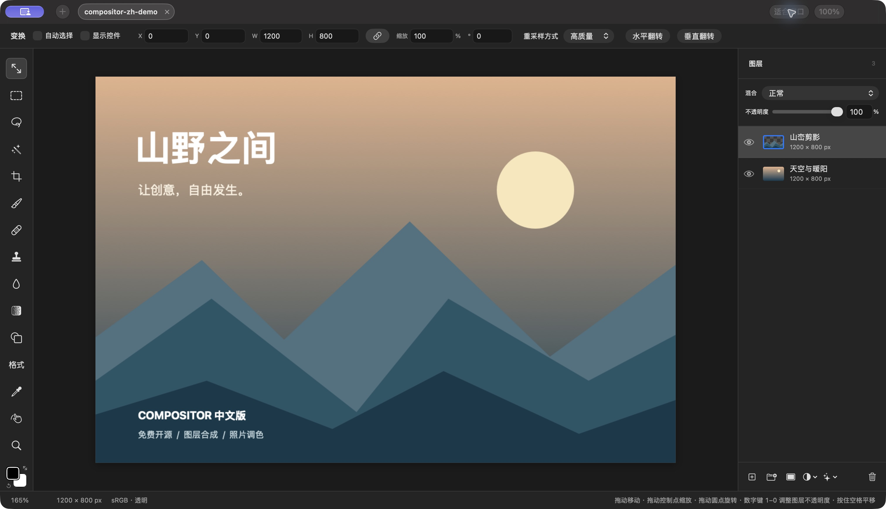

# Compositor 中文版

**免费开源的中文 Photoshop 替代工具，专为 Apple Silicon Mac。**

想找一款“免费中文版 PS”，用来修照片、抠图、做海报和多图合成？Compositor-ZH 提供熟悉的图层、蒙版、选区、画笔与调色工作流，配合简体中文界面，无订阅费用。

这是 [Compositor](https://github.com/robbietilton/Compositor) 的独立汉化 fork，基于 **v1.5.3**。它不是 Adobe Photoshop，不使用 Adobe Camera Raw 引擎，也不承诺与 Photoshop 功能或文件效果完全一致。

[下载中文版](https://github.com/qidian2022/Compositor-ZH/releases/tag/v1.5.3-zh.1) · [反馈问题](https://github.com/qidian2022/Compositor-ZH/issues) · [构建说明](docs/build-zh.md) · [版本记录](CHANGELOG.md)



*截图来自采用相同中文编辑界面源码的本地预览构建，使用专门制作的演示素材。*

## 下载与安装

- **系统：macOS 26.0 或更新版本；芯片：Apple Silicon（M 系列）。** 此版本不提供 Intel Mac 或 Windows 安装包。
- 在 [Releases](https://github.com/qidian2022/Compositor-ZH/releases) 下载 `Compositor-ZH-1.5.3-zh.1-arm64.zip`，解压后把 `Compositor 中文版.app` 拖到“应用程序”。
- 首版是**预览版**：只有 ad-hoc 临时签名，**没有 Developer ID 签名及 Apple 公证**，macOS 可能阻止打开。校验值只用于核对下载完整性，并不等于 Apple 安全认证。可从本仓库源码自行构建；如选择运行下载版本，请先确认来源，再参阅 [Apple 的安全打开应用说明](https://support.apple.com/zh-cn/102445)。不需要关闭 Gatekeeper 或更改全局安全设置。
- 请从本 fork 下载中文版。上游官网、Homebrew 包和上游 Release 提供的是原版。
- 更新时从本仓库下载新包并替换应用；本分支已移除自动更新，避免被上游英文版覆盖。替换前保存项目。

可选的下载校验（把 ZIP 和 `SHA256SUMS.txt` 放在同一目录）：

```sh
shasum -a 256 -c SHA256SUMS.txt
```

## 能做什么

以下功能来自本分支基于的 v1.5.3 源码；中文适配主要改变显示文本，不另造图像引擎。

| 使用场景 | 支持的功能 |
| --- | --- |
| 多图合成 | 图层与分组、不透明度、混合模式、图层蒙版、剪贴蒙版、调整图层、合并与复制 |
| 抠图与选区 | 矩形/椭圆选框、套索/多边形套索、魔棒、对象/主体选择、扩展/收缩/羽化、内容识别填充 |
| 修图与绘画 | 画笔、橡皮擦、修复画笔、仿制图章、模糊、涂抹、液化、吸管 |
| 排版与变换 | 可编辑文字与形状、渐变、移动/缩放/旋转/翻转、自由扭曲、裁剪、标尺/参考线/网格/吸附 |
| 色彩与质感 | 色阶、曲线、色相/饱和度、曝光、黑白、色彩平衡、渐变映射、颗粒、模糊、暗角和辉光等 |
| RAW 工作流 | 相机 RAW 导入显影；导入后可用 RAW 调色滤镜继续调整光线、色彩、曲线、混色、色彩分级、细节和几何 |
| 输出与印刷 | PNG、JPEG、TIFF、单页 PDF、EXR；部分格式提供 16 位或 HDR 路径；CMYK 软打样、色域警告和支持的格式转出 |
| 日常操作 | 多项目标签、撤销/重做、中文命令搜索、可自定义快捷键、原生 `.comp` 项目保存 |

## 快速开始

1. 打开应用，新建画布或打开图片，也可把图片拖入画布。
2. 在左侧选择工具；在右侧图层面板调整顺序、不透明度和混合模式。
3. 修照片时打开调色滤镜；多图合成时结合蒙版、文字和形状。
4. 按 `⌘S` 保存为 `.comp`，保留可继续编辑的项目。
5. 使用“文件”菜单导出成图片；`⇧⌘E` 导出 PNG，`⇧⌥⌘S` 导出 JPEG。导出图片与保存项目是两件事。

常用快捷键：`V` 移动、`B` 画笔、`E` 橡皮擦、`T` 文字、`⌘F` 搜索命令、`⌘Z` 撤销。找不到某个操作时，可以先按 `⌘F` 搜索中文名称。

## RAW 显影和 RAW 调色滤镜有什么区别？

**导入显影**读取相机 RAW 原始数据，使用 macOS Core Image 的 `CIRAWFilter`。可以先调整曝光、白平衡、色调、降噪，以及相机和文件支持的镜头校正/高光恢复，然后生成图层。相机兼容性随运行系统变化，并非所有扩展名相同的 RAW 都一定能打开。请核对 [Apple 的 macOS 26 RAW 相机支持列表](https://support.apple.com/zh-cn/122870)。该列表包含 Nikon Z30；**本分支尚未使用 Z30 NEF 实拍文件测试**。

**RAW 调色滤镜**用于已经进入编辑器的图像，包括 JPEG、PNG 和已显影的 RAW 图层。它提供类似摄影软件的调色面板，但不会把普通图片变回相机原始数据，也不等于重新读取 RAW。实现来自 Compositor，自带调色逻辑与查找表，不是 Adobe Camera Raw 插件。

建议保留原始 RAW 文件，便于之后重新显影；不要把 `.comp` 当作 RAW 原片的备份。

## 格式与兼容边界

| 格式 | 当前范围与限制 |
| --- | --- |
| 常见图片 | 导入 JPEG、PNG、HEIC/HEIF、TIFF、WebP；具体解码依赖系统框架 |
| SVG | 导入时栅格化为图像图层，不保持 SVG 矢量可编辑性 |
| PSD / PSB | 分层读取支持 **8 位 RGB 与 8 位 CMYK**；CMYK 通过 ICC 配置转换为 RGB 编辑。分组、蒙版、混合模式及部分文字/形状可保留；其他内容可能栅格化或降级，导入时查看转换报告 |
| 16 位图像 | 源码有 16 位 PNG/TIFF 等图像图层及相关编辑/输出路径；这**不代表支持 16 位分层 PSD**，也不代表每个工具始终以 16 位精度工作 |
| HDR / EXR | 有 HDR 图层与 EXR 导入/导出路径；显示效果取决于素材、显示器和系统。未完成完整 HDR 工作流验证 |
| 导出 | PNG、JPEG、TIFF、单页 PDF、EXR；没有 PSD/PSB 导出，不提供 Photoshop 的无损往返编辑保证 |
| `.comp` | 原生项目保留图层等编辑信息。中文显示不改变混合模式等内部英文标识；跨版本使用前建议备份 |

复杂 PSD 的智能对象、特殊效果、字体和色彩结果可能与 Photoshop 不同，不能将本项目视为 Photoshop 的完全兼容替代品。大型文件还受内存与应用文档尺寸预算限制。

## 中文化范围与已知限制

首版包含 **1128 条翻译**，覆盖主要菜单、工具、RAW 调色面板、混合模式、保存导出和大量帮助提示。部分动态错误提示仍可能显示英文；用户自己填写的图层名、文件名不会自动翻译。

发布前的验证及未测范围记录在 [验证说明](docs/validation-zh.md)。目前未完成完整上游 Xcode 测试套件、全部 PSD 样本、相机 RAW 和 HDR 工作流测试，请先用文件副本试用。

## 从源码构建

不需要先安装英文版。资源全部来自仓库，不依赖私人路径或开发者证书。可使用匹配的 Apple Command Line Tools/macOS SDK 构建；也保留 Xcode 工程。

```sh
git clone --branch zh-Hans https://github.com/qidian2022/Compositor-ZH.git
cd Compositor-ZH
python3 localization/build.py
```

产物位于 `build/Compositor 中文版.app`。如果工具链包含多个 SDK，可通过 `--sdk` 指定匹配版本；详见 [构建与打包说明](docs/build-zh.md)。

## 反馈与贡献

请到 [本仓库 Issues](https://github.com/qidian2022/Compositor-ZH/issues) 提交问题，附上中文版版本号、macOS 版本、芯片、复现步骤和不含隐私的截图。文件兼容问题可使用最小化的公开测试文件；不要上传私人照片、客户素材或账号信息。

翻译源在 `localization/zh-Hans.tsv`。修改后运行 `python3 localization/generate.py`，并提交生成的资源文件。不要修改枚举原值、快捷键内部标识或项目序列化字段来翻译界面。

## 开源许可与致谢

MIT 许可，见 [LICENSE](LICENSE) 与 [NOTICE](NOTICE.md)。感谢 **Robbie Tilton / Wonder Assembly LLC** 开源 Compositor。本仓库保留上游 Git 历史、版权及许可，是独立中文分支；中文分支的问题请在这里反馈。

Photoshop 和 Adobe Camera Raw 是 Adobe 的产品名称。本项目与 Adobe 无关联。
